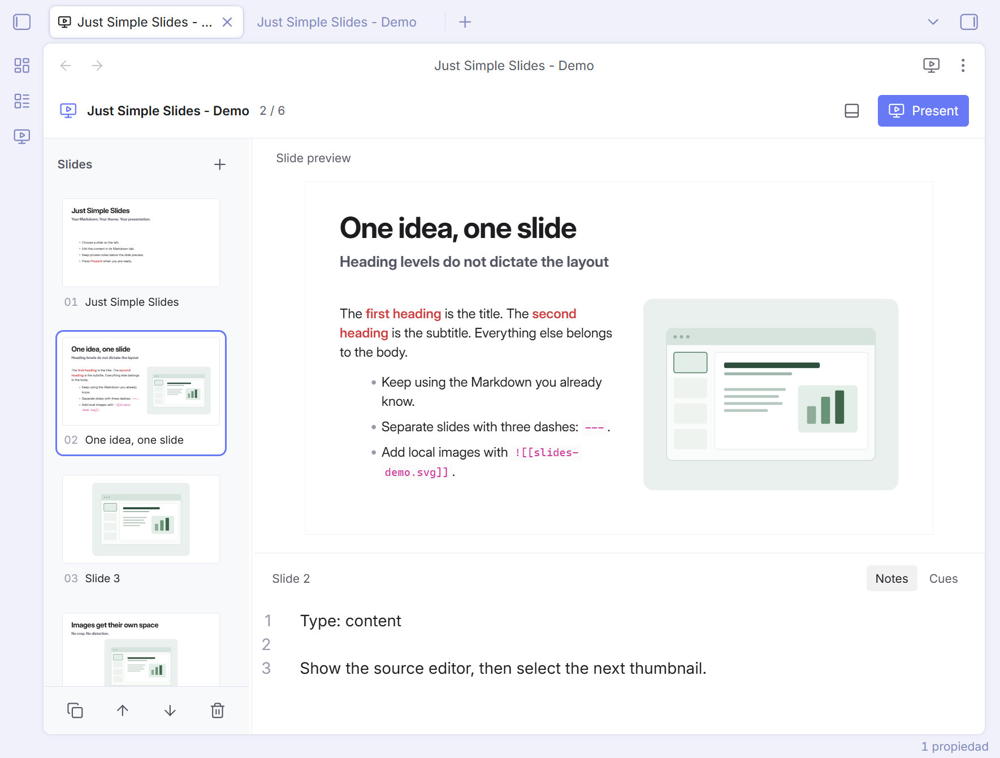
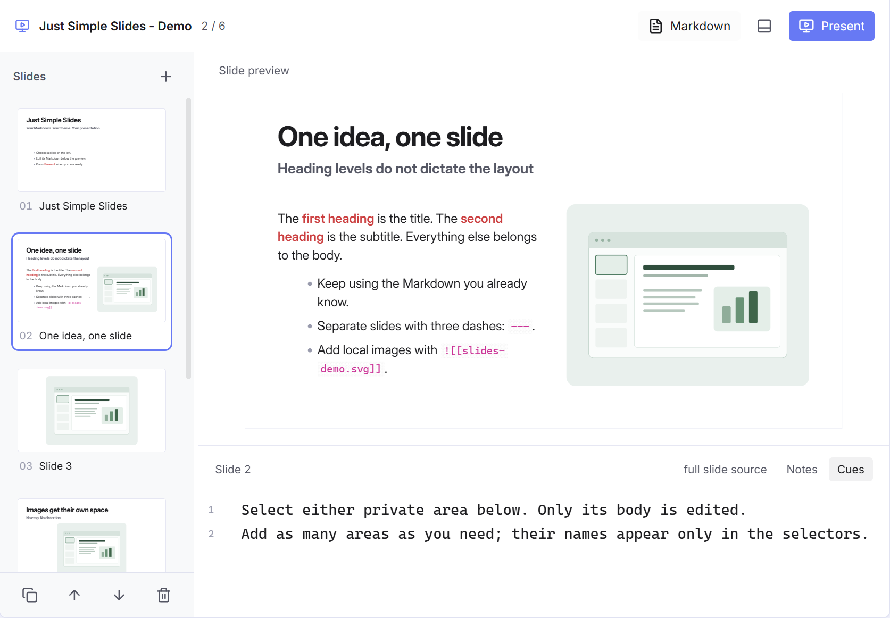

# Just Simple Slides

**A minimalist visual editor for Markdown presentations in Obsidian.**

Markdown Slides can put a note on a screen. That alone is not enough to build a serious presentation.

PowerPoint is the best tool for slide design. But for developing the content — writing, structuring ideas, and revising the story — working inside slide objects gets in the way.

Markdown is the perfect format for content: plain text, easy to edit, easy to reuse, and yours to keep. What was missing was a visual editor for working with that content as a presentation.

**Just Simple Slides fills that gap.** See the slides, reorder the story, and keep private notes below the preview. Edit your content in Obsidian's native Markdown editor, which stays open in its own tab. Both views share the same ordinary Markdown file. The layout adjusts automatically and follows your Obsidian theme.

[Download the latest release](https://github.com/DavidHurtadoAI/just-simple-slides/releases/latest) · [Installation](#installation) · [Markdown format](#markdown-format)



## Start here

1. Open a Markdown note.
2. Run **Just Simple Slides: Edit as slides**, click the presentation ribbon icon, or right-click the note and choose **Edit as slides**. The slide view opens in a new tab, keeping your Markdown editor, selection, and undo history in place.
3. Pick a thumbnail on the left. Click **Edit source** to focus the existing Markdown editor at that slide, including in another Obsidian window. If the note was closed, a new Markdown tab opens. Select a private `[!slide]` area below the preview to edit its notes. You can also move or split the tabs using Obsidian's normal window controls.
4. Click **Present**, press **F5**, or run **Just Simple Slides: Start presentation**.
5. Press **Esc** to return to the same slide. Close the Just Simple Slides tab with its native **×** or **Ctrl/Cmd+W** when finished; your Markdown tab stays open.

Use **Just Simple Slides: Create presentation** for a new file. New, duplicate, move up/down, and delete controls are beside the thumbnail rail. **Ctrl/Cmd+Z** undoes edits and slide operations, including after selecting another slide; **Ctrl/Cmd+Shift+Z** or **Ctrl+Y** redoes them.

Drag a thumbnail above or below another to reorder slides. An accent line marks the drop position, and the rail scrolls near its edges. The moved slide stays selected; the Markdown file updates automatically, including its private notes. A reorder is one undo step. Dropping outside the rail cancels the move.

Drag the divider beside the thumbnails to change their width. Drag the divider above the lower editor to change its height. Double-click a divider to reset it, or focus it and use the arrow keys. Panel sizes and the selected private area are remembered.

## Markdown format

```md
> [!slide] Notes
> Type: content
>
> Presenter notes: introduce the idea, then pause.

### My slide title

###### Optional subtitle

Some **Markdown** text.

![[image.png]]

---

![[another-image.png]]
```

- A line containing `---` separates slides, outside fenced code or HTML comments. A standard YAML block at the start remains frontmatter.
- The first heading, at any level, becomes the title. The second becomes the subtitle. Later headings stay in the body. A heading is optional.
- Text alone uses the available width. Standalone images alone appear large and centered. Text and standalone images share two columns. Multiple standalone images form a grid.
- Local Obsidian image embeds and standard Markdown images use Obsidian's Markdown renderer. Inline images inside rich blocks stay in their original block.
- Images preserve their complete aspect ratio. Text and long titles shrink to fit the fixed 16:9 slide. Dense content remains visible but can become small; the editor identifies dense slides.
- Lists, tables, code, callouts, math, and other Markdown rendered by Obsidian remain content. Preview task checkboxes are read-only.
- Edits retain the original file's frontmatter and untouched slide content. When the native editor saves, its newline convention applies. There is no sidecar format or conversion.

## Private slide areas

An optional [Obsidian callout](https://obsidian.md/help/callouts) creates a private editing area:

```md
> [!slide] Notes
> Type: content
>
> Presenter notes: introduce the idea, then pause.

# My slide

This is visible content.

> [!slide] Cues
> Two minutes. Ask the audience a question.
```

We recommend keeping the slide type and presenter notes together in one area, as above. This is a convention: the plugin does not interpret the name, type, or any other field. Write any Markdown you need. The name, body, type, and entire callout are all optional. A slide can have no private areas or as many as you want.

The lower editor contains only private areas: one selector for each `[!slide]` callout in that slide, in source order. A callout's optional name appears only in its selector, apart from the Markdown source. Unnamed areas use **Area 1**, **Area 2**, and so on; repeated names remain separate selectors. Use Left/Right, Home, or End on the selectors to switch areas. The row scrolls when needed. A slide without private areas shows a short hint instead of an editable field.

Selecting a private area edits only its body, without the quote markers or header. The editor uses Obsidian's configured text font and size. Switching areas leaves the file unchanged; edits appear in the original Markdown tab and save to the same file. Clearing a body keeps the empty callout. Add, rename, or remove areas in the native Markdown editor; selectors update as you type. Put a blank line between separate callouts, following normal Obsidian Markdown.

You can move the slide view into a floating Obsidian window for another monitor. Private areas remain editable there, including after switching slides, resizing the window, or returning from fullscreen.

Every `[!slide]` callout stays out of the preview, thumbnails, and presentation, including folded callouts. Its name never becomes a slide title or a layout instruction. All other callout types remain visible. New slides include one suggested **Notes** area; existing notes work unchanged, and existing callout titles are simply selector names.



## Presenting

**Right / Down / Space / Enter / Page Down** advances. **Left / Up / Backspace / Page Up** goes back. **Home / End** jumps to the first/last slide. Click an empty part of the slide to advance. Navigation and exit buttons remain available below the slide. The player attempts native fullscreen and falls back to an app-filling overlay when the WebView does not support it.

The background, text, accent, and fonts come from Obsidian's CSS variables. No slide transitions are included in this first version.

## Installation

Requires **Obsidian 1.7.2 or later**.

1. Download `main.js`, `manifest.json`, and `styles.css` from the [latest release](https://github.com/DavidHurtadoAI/just-simple-slides/releases/latest).
2. Put all three files into `<vault>/.obsidian/plugins/just-simple-slides/`.
3. Reload Obsidian and enable **Just Simple Slides** in **Settings → Community plugins**.

The plugin is published on GitHub and is not yet listed in Obsidian's Community Plugins directory. From 0.1.6, releases contain only the three files Obsidian installs. Each file is built and signed with GitHub artifact attestations; verify a download with `gh attestation verify main.js --repo DavidHurtadoAI/just-simple-slides` (and likewise for the other files).

Copy both files from `demo/` to a vault to try the six-slide example.

## Minimal by design

The priority today is **editing a Markdown file as a presentation**: seeing the slides, shaping the content, arranging their order, and keeping private notes nearby.

Future versions will improve presentation mode with restrained **animations and transitions**. They will stay simple and optional. The editor and the presentation experience will remain minimalist: a small set of useful controls, sensible defaults, and your content at the center.

## Development

`npm run check` runs the official Obsidian ESLint rules, CSS checks for Chromium 114 and `!important`, unit tests, strict TypeScript, and release packaging. Warnings fail the check. Version tags trigger the build, provenance attestation, and publication workflow.

```sh
npm ci
npm run check
node scripts/install.mjs /path/to/vault
```

Uses the [Obsidian TextFileView API](https://github.com/obsidianmd/obsidian-api) for file lifecycle, CodeMirror for private callout bodies, and [Obsidian's Markdown renderer and component lifecycle](https://docs.obsidian.md/plugins/guides/lifecycle-management) for previews. While the native Markdown editor is open, it owns saving and receives minimal text replacements that preserve its undo history. All open slide tabs share the current content. The same measured layout renders the main preview, visible thumbnails, and player. Thumbnails render lazily. No web service, telemetry, presentation framework, or runtime download is required.

The public Obsidian API does not provide an embeddable native editor restricted to a document fragment. The private-area editor uses the same CodeMirror engine and Obsidian typography; full native Live Preview, autocomplete, and Markdown editing remain available in the original note tab. Slide transitions, export, and a separate presenter window are outside this first version. Arbitrary third-party interactive embeds may impose their own layout or focus behavior.

See [VALIDATION.md](VALIDATION.md) for the local test results and platform coverage.
