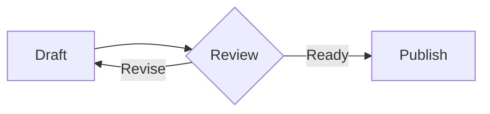
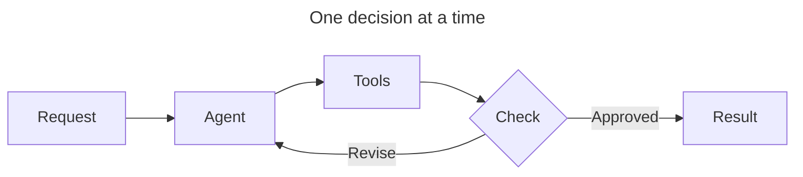
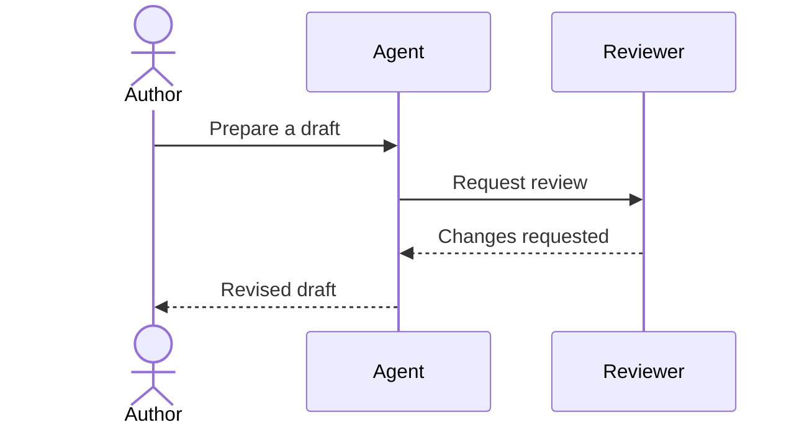
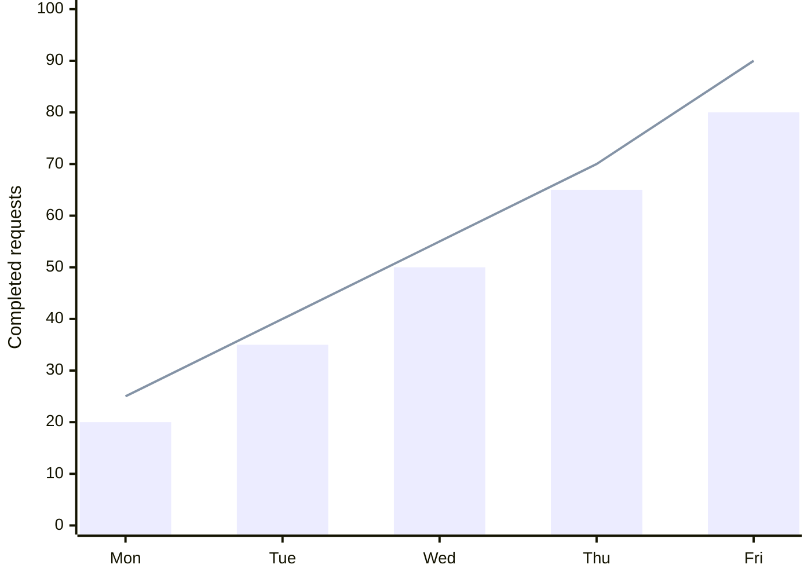
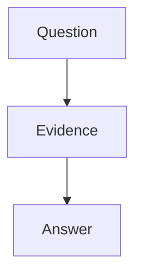
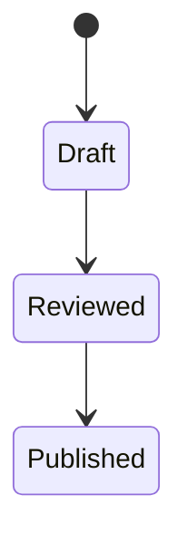

# Images still work

![[slides-demo.svg]]

> [!slide] Notes
> Existing images stay unchanged. These notes stay private.
>
> ```mermaid
> flowchart LR
>   Private --> Hidden
> ```

---

# Text, image and diagram

- Write the explanation in Markdown.
- Keep the existing illustration.
- Edit the process as Mermaid text.



![[slides-demo.svg]]

> [!slide] Notes
> Text shares the slide with both visual resources.

---

# A flow with its own frontmatter



---

# A sequence



---

# An XY chart



---

# Two independent diagrams





---

# A comprehensible error

```mermaid
flowchart LR
  A -->
```

---

# A literal example

The following is Markdown source, not a live diagram:

````markdown

````
